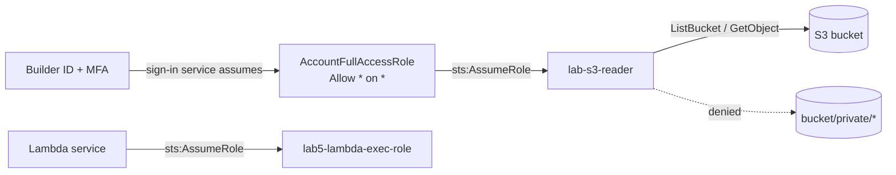

# Lab 1 — IAM foundations

**Goal:** understand who can do what in AWS, and why.
**Cost:** free. **Region:** us-east-2. **Account:** AWS project-based sign-up (Builder ID, Free plan).

## What I built

| Resource | Type | Purpose |
|---|---|---|
| `saa-lab1-<suffix>` | S3 bucket | Test bucket with `allow.txt.rtf` and `private/private.txt.rtf` |
| `lab-s3-read` | Customer managed policy | `s3:ListBucket` on the bucket, `s3:GetObject` on `bucket/*` |
| `lab-s3-reader` | IAM role | Trusted by this account; assumed from CloudShell to test |
| `deny-private` | Inline policy on the role | Explicit deny of `s3:GetObject` on `bucket/private/*` |
| `region-lock` | Inline policy on the role | Allow `ec2:DescribeInstances`; deny everything outside us-east-2 |
| `lab5-lambda-exec-role` | Service role | Trusted by Lambda, `AWSLambdaBasicExecutionRole`; kept for Lab 5 |



## Every role has two policies

- **Trust policy** — *who* may become the role.
- **Permissions policy** — *what* the role may do once assumed.

Assuming a role needs **both** sides to say yes: the caller's own policy must allow `sts:AssumeRole`, and the role's trust policy must name the caller.

| Role | Trusted principal | Who can become it |
|---|---|---|
| `AccountFullAccessRole` | `Service: account-access.amazonaws.com` | AWS's sign-in service, on my behalf |
| `lab-s3-reader` | `AWS: arn:aws:iam::ACCOUNT_ID:root` | Any principal in this account whose own policy allows it (not just root) |
| `lab5-lambda-exec-role` | `Service: lambda.amazonaws.com` | Only the Lambda service |

## Policy for the role

`ListBucket` applies to the bucket ARN; `GetObject` applies to the objects (`bucket/*`).

```json
{
  "Version": "2012-10-17",
  "Statement": [
    { "Effect": "Allow", "Action": "s3:ListBucket", "Resource": "arn:aws:s3:::BUCKET" },
    { "Effect": "Allow", "Action": "s3:GetObject",  "Resource": "arn:aws:s3:::BUCKET/*" }
  ]
}
```

## How AWS decides

```
1. Any explicit Deny matches?  → DENY (stop)
2. Any Allow matches?          → ALLOW
3. Nothing matched             → DENY (implicit)
```

And on top of the identity policy, outside limits still apply (permissions boundaries, SCPs, account guardrails). `AccountFullAccessRole` allows `*`, yet the account is still locked to one region — that limit lives outside the role.

## Reading the error messages

| Test (as `lab-s3-reader`) | Error ending | Kind |
|---|---|---|
| `aws s3 mb s3://...` | `because no identity-based policy allows the s3:CreateBucket action` | Implicit deny — nothing said yes |
| `GetObject` on `private/...` | `with an explicit deny in an identity-based policy` | Explicit deny — a policy said no |
| `ec2 describe-instances --region us-west-2` | `UnauthorizedOperation ... with an explicit deny in an identity-based policy` | Condition-based deny (`aws:RequestedRegion`) |

Fix for an implicit deny: add an Allow. Fix for an explicit deny: find the Deny (identity policy, bucket policy, boundary or SCP) — more Allows won't help.

## Things I learned the hard way

- **404 vs 403 in S3.** With `s3:ListBucket`, a missing object returns 404. Without it, S3 returns 403 so it doesn't reveal whether the object exists.
- **`aws s3 cp` hides the reason.** It sends `HeadObject` first; HEAD responses have no body, so you only see `403 Forbidden`. `aws s3api get-object` shows the full message.
- **Shell variables vanish.** CloudShell forgets `$BUCKET` in a new session or tab, which left a policy with `arn:aws:s3:::` (no bucket). Check with `echo "[$BUCKET]"` before a heredoc, or hard-code the value with `<<'EOF'`.
- **`sed` isn't idempotent.** Running the same substitution twice doubled the bucket name. Rewrite the whole file instead.
- **Managed policies keep versions** (up to 5). Fix one with `create-policy-version --set-as-default`; every role it's attached to picks up the change.
- **Managed vs inline.** Managed policies stand alone and can attach to many roles; inline policies live inside one role and are deleted with it.
- **Role and policy names are separate namespaces.** `lab-s3-read` (policy) vs `lab-s3-reader` (role) caused a `NoSuchEntity` mix-up.
- **EC2 says `UnauthorizedOperation`, S3 says `AccessDenied`** — same meaning, different code.
- **Role chaining** (assuming a role from a role session) caps the session at 1 hour.
- **Session names show up in CloudTrail.** `assumed-role/lab-s3-reader/test` — use something meaningful in real accounts.

## Not available in this account (read only)

Console IAM users and groups, MFA for IAM users, IAM Access Analyzer, console **Switch role**, root user sign-in. In this setup I sign in with a Builder ID and get temporary credentials for a role — which is what the "don't use root" advice is aiming for. Creating an IAM user here would mean long-lived access keys, a step backward.

## Cleanup

```bash
unset AWS_ACCESS_KEY_ID AWS_SECRET_ACCESS_KEY AWS_SESSION_TOKEN

aws iam delete-role-policy --role-name lab-s3-reader --policy-name deny-private
aws iam delete-role-policy --role-name lab-s3-reader --policy-name region-lock
aws iam detach-role-policy --role-name lab-s3-reader --policy-arn arn:aws:iam::ACCOUNT_ID:policy/lab-s3-read
aws iam delete-role --role-name lab-s3-reader      # fails while policies are still attached
aws iam delete-policy --policy-arn arn:aws:iam::ACCOUNT_ID:policy/lab-s3-read

aws s3 rm s3://BUCKET --recursive
aws s3 rb s3://BUCKET
```

Kept: `lab5-lambda-exec-role` (for Lab 5).

## Exam takeaways

- Users vs groups vs roles; groups can't nest, roles can't join groups.
- Identity-based vs resource-based policies (trust policies and bucket policies are resource-based).
- Explicit deny always wins; no Allow means implicit deny.
- `ListBucket` → bucket ARN; `GetObject` → `bucket/*`.
- Roles give temporary credentials through STS; prefer roles over long-lived access keys.
- Never use root for daily work.
- `aws:RequestedRegion` conditions restrict regions — usually as an SCP across an organization.
