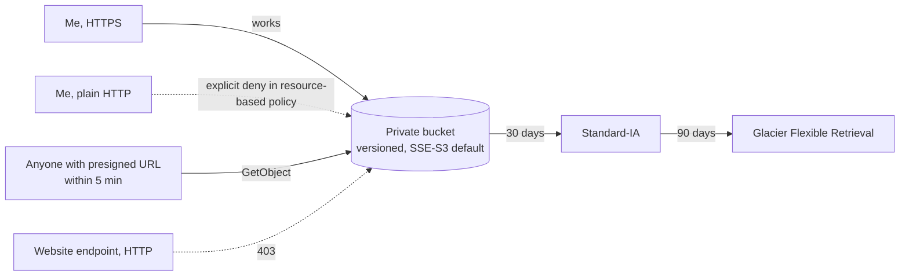

# Lab 2 — S3 in depth

**Goal:** the S3 features the exam tests most.
**Cost:** pennies (a few small files). **Region:** us-east-2. **Sessions:** two, about an hour each.

## What I built

| # | Feature | What I did |
|---|---|---|
| 1 | Bucket | `saa-lab2-<suffix>`: ACLs disabled, Block Public Access on, default SSE-S3 + Bucket Key, tag `project=saa-lab` |
| 2 | Versioning | Enabled it, overwrote a file, deleted it, then restored it by removing the delete marker |
| 3 | Encryption | One object with SSE-S3, one with SSE-KMS (`aws/s3` AWS managed key) |
| 4 | Lifecycle | Transitions, noncurrent-version expiration, delete-marker and multipart cleanup |
| 5 | Bucket policy | Deny any request over plain HTTP (`aws:SecureTransport`) |
| 6 | Presigned URL | 5-minute link to a private SSE-KMS object |
| 7 | Static website | Enabled hosting; endpoint stays 403 (private bucket, HTTP-only endpoint) |
| 8 | Cross-region replication | Read only — account is locked to one region |



## Versioning

A delete in a versioned bucket doesn't erase anything — it adds a **delete marker** on top:

```
Before delete:  notes.txt  v2 (latest)   v1 "null"
After delete:   notes.txt  MARKER (latest)   v2   v1 "null"   → GET returns 404
Remove marker:  notes.txt  v2 (latest)   v1 "null"            → file is back
```

- Objects uploaded before versioning was enabled get version ID `null`.
- To truly delete, delete a specific **version ID**. MFA Delete (root only, CLI only) protects that action.
- Three states: unversioned → enabled → suspended. Once enabled, it can never go back to unversioned.
- Every version is billed — pair versioning with a lifecycle rule.
- Undo a delete from the CLI: `aws s3api delete-object --bucket BUCKET --key KEY --version-id <marker-id>` (returns `"DeleteMarker": true`).

## Encryption

| | SSE-S3 | SSE-KMS |
|---|---|---|
| API name | `AES256` | `aws:kms` |
| Key managed by | S3, hidden | KMS (`aws/s3` or a customer managed key) |
| Separate decrypt permission | No | Yes, `kms:Decrypt` on the key |
| CloudTrail logs key use | No | Yes |
| Cost | Free | KMS requests (Bucket Key reduces them); customer managed key has a monthly fee |

- Check an object: `aws s3api head-object --bucket BUCKET --key KEY --query '{SSE:ServerSideEncryption,Key:SSEKMSKeyId,BucketKey:BucketKeyEnabled}'`
- Re-encrypting an object means writing a new copy (`aws s3 cp s3://B/K s3://B/K --sse aws:kms`) — with versioning on, the old version stays underneath.
- Exam: "audit key use / separate key permissions" → SSE-KMS. "Least overhead" → SSE-S3. "Customer holds the key" → SSE-C or client-side. "Reduce KMS cost for S3" → Bucket Keys.

## Lifecycle rule (final)

```json
{
  "ID": "lab-lifecycle",
  "Filter": {},
  "Status": "Enabled",
  "Transitions": [
    { "Days": 30, "StorageClass": "STANDARD_IA" },
    { "Days": 90, "StorageClass": "GLACIER" }
  ],
  "NoncurrentVersionExpiration": { "NoncurrentDays": 30 },
  "Expiration": { "ExpiredObjectDeleteMarker": true },
  "AbortIncompleteMultipartUpload": { "DaysAfterInitiation": 7 }
}
```

| Storage class | Minimum days billed | Retrieval |
|---|---|---|
| Standard | none | instant |
| Standard-IA / One Zone-IA | 30 | instant, per-GB fee |
| Glacier Instant Retrieval | 90 | milliseconds |
| Glacier Flexible Retrieval (`GLACIER`) | 90 | minutes to hours |
| Glacier Deep Archive | 180 | up to 12+ hours |

- **Transition** moves data to a cheaper class (you still keep it). **Expiration** deletes it. "Remove old versions to cut cost" → expiration.
- Objects under 128 KB aren't transitioned by default (`TransitionDefaultMinimumObjectSize: all_storage_classes_128K`).
- Unknown or changing access patterns → S3 Intelligent-Tiering.

## Enforce HTTPS (bucket policy)

```json
{
  "Version": "2012-10-17",
  "Statement": [{
    "Sid": "DenyInsecureTransport",
    "Effect": "Deny",
    "Principal": "*",
    "Action": "s3:*",
    "Resource": ["arn:aws:s3:::BUCKET", "arn:aws:s3:::BUCKET/*"],
    "Condition": { "Bool": { "aws:SecureTransport": "false" } }
  }]
}
```

Test over HTTP: `aws s3 ls s3://BUCKET --endpoint-url http://s3.us-east-2.amazonaws.com`

| Where the Deny lives | Error ending |
|---|---|
| Inline policy on a role (Lab 1) | `explicit deny in an identity-based policy` |
| Bucket policy (this lab) | `explicit deny in a resource-based policy` |

It blocked my admin role too — an explicit deny wins regardless of where it lives. Block Public Access doesn't object to it, because it only blocks policies that *grant* public access.

## Presigned URLs

`aws s3 presign s3://BUCKET/KEY --expires-in 300`

| URL part | Meaning |
|---|---|
| `X-Amz-Credential=ASIA...` | Signed with temporary credentials (`AKIA` = long-term keys) |
| `X-Amz-Date` + `X-Amz-Expires` | Signing time and lifetime — fixed, covered by the signature |
| `X-Amz-Security-Token` | Session token; present when signed with temporary credentials |
| `X-Amz-Signature` | Change any character and the URL fails |

- Expiry is fixed at signing; using the link doesn't extend it. S3 keeps no record of presigned URLs.
- Reusable any number of times until expiry; can't be revoked individually.
- Can't do more than the signer could; stops working early if the signer's temporary credentials expire.
- Works for uploads (PUT) too — the usual browser-upload pattern.
- **Test expiry with `curl` or a private window** — my browser showed a cached copy after expiry. curl showed `Request has expired` with `Expires` vs `ServerTime`.

## Static website hosting

- Website endpoint: `http://BUCKET.s3-website.us-east-2.amazonaws.com` — **HTTP only**, returns HTML errors. REST endpoint (`s3.us-east-2...`) returns XML errors.
- Mine returned 403 for three reasons: Block Public Access, no policy allowing anonymous `GetObject`, and the HTTPS-only deny (website requests are always HTTP).
- For HTTPS or a custom domain, put CloudFront in front with origin access control (Lab 9) — the bucket stays private.

## Cross-region replication (read only)

- Versioning required on **both** buckets; S3 uses an IAM role (trusts `s3.amazonaws.com`).
- Only new objects replicate; existing ones need S3 Batch Replication.
- Delete markers not replicated by default; version-specific deletes never are.
- Not chained: A→B→C doesn't carry A's objects to C.
- CRR for DR and latency; SRR for log aggregation and cross-account copies.
- Replication Time Control: 99.99% within 15 minutes, with an SLA.
- SSE-KMS objects need the role to have access to the keys in both regions.

## Things I learned the hard way

- The SSE-KMS choice in the console upload screen is easy to miss — the object silently got the bucket default (SSE-S3). Always verify with `head-object`.
- In the lifecycle editor, *Transition noncurrent versions* and *Permanently delete noncurrent versions* sit side by side. I picked the wrong one first — always read back the config with `get-bucket-lifecycle-configuration`.
- TextEdit saves `.rtf` by default; use **Format → Make Plain Text** for lab files.

## Cleanup

- `aws s3 rm --recursive` only adds delete markers in a versioned bucket.
- Console **Empty** removes every version and marker; then **Delete** the bucket. Policy, lifecycle rule and website settings go with it.
- The `aws/s3` key remains (AWS managed, no monthly fee).
- Confirm: `aws s3 ls | grep saa-lab` prints nothing.

## Exam takeaways

- Storage classes, minimum durations, and lifecycle transition vs expiration.
- Versioning + MFA Delete for protection; delete markers.
- SSE-S3 vs SSE-KMS vs SSE-C; Bucket Keys for KMS cost.
- Bucket policies (resource-based) vs IAM policies (identity-based); `aws:SecureTransport` for encryption in transit.
- Block Public Access; ACLs disabled by default.
- Presigned URLs for temporary access to private objects.
- Website endpoints are HTTP only → CloudFront for HTTPS.
- Replication needs versioning on both buckets and only covers new objects.
