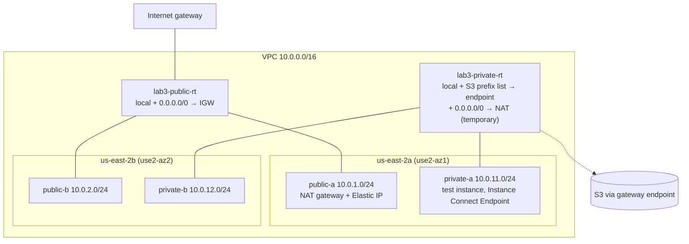

# Lab 3 — VPC by hand

**Goal:** build a two-AZ VPC piece by piece and see what makes a subnet public or private.
**Cost:** a few cents (NAT gateway + Elastic IP + t3.micro for about 30 minutes). Everything else is free. **Region:** us-east-2.

## What I built



| Resource | Notes |
|---|---|
| `lab3-vpc` | `10.0.0.0/16`, created with **VPC only** (not the wizard) |
| 4 subnets | public-a `10.0.1.0/24`, public-b `10.0.2.0/24`, private-a `10.0.11.0/24`, private-b `10.0.12.0/24` |
| `lab3-igw` | Attached to the VPC |
| `lab3-public-rt` | `0.0.0.0/0 → IGW`; public subnets |
| `lab3-private-rt` | Local only; private subnets. Main route table left untouched. |
| `lab3-web-sg` | HTTPS in from anywhere; all traffic out |
| `lab3-public-nacl` | 443 + ephemeral ports both ways; public subnets |
| `lab3-s3-gw` | S3 gateway endpoint on `lab3-private-rt` |
| `lab3-nat-a` | Zonal, public NAT gateway in public-a with an Elastic IP (about 30 minutes) |
| `lab3-eice`, `lab3-private-sg`, `lab3-ec2-s3-role`, `lab3-test` | Test setup: Instance Connect Endpoint, SSH from the VPC, S3 read-only role, t3.micro with no public IP |

## Subnets and addressing

- `/16` = first 16 bits fixed (`10.0.x.x`, 65,536 addresses). `/24` = first 24 bits fixed (256 addresses).
- **251 usable per /24** — AWS reserves 5: network, VPC router, DNS, future use, broadcast.
- A subnet lives in exactly one AZ. High availability = matching subnets in two or more AZs.
- AZ **names** are mapped per account; AZ **IDs** (`use2-az1`) are the same in every account.
- "Name" in the console is just a tag with key `Name`. My first VPC had no name until I added the tag.
- Default VPC: `172.31.0.0/16`, public subnet in every AZ, internet gateway, auto-assigned public IPs. Convenient, not for production.

## What makes a subnet public

A **route** — `0.0.0.0/0 → internet gateway` — in the subnet's route table. That's the only difference.

- Every VPC gets a main route table (`local` only). Leave it private; give subnets explicit tables.
- An instance in a public subnet also needs a public IP. Public IPv4 addresses cost money by the hour.
- Most specific route wins: `10.0.0.0/16 → local` beats `0.0.0.0/0`; the S3 prefix list beats `0.0.0.0/0`.
- One internet gateway per VPC. Free, scaled by AWS, translates private IPs to public ones.

## Security groups vs network ACLs

| | Security group | Network ACL |
|---|---|---|
| Applies to | Network interface (instance) | Whole subnet |
| Stateful? | Yes — replies allowed automatically | No — replies need their own rules |
| Rules | Allow only | Allow and deny |
| Evaluation | All rules together | Lowest number first; first match wins |
| Default | New group: inbound denied, outbound allowed | Default NACL allows all; a custom NACL denies all |

My public NACL:

| Direction | Rule | Ports | Why |
|---|---|---|---|
| Inbound | 100 | 443 | HTTPS requests in |
| Inbound | 110 | 1024–65535 | Replies to connections the subnet opened |
| Outbound | 100 | 1024–65535 | Replies to visitors' ephemeral ports |
| Outbound | 110 | 443 | HTTPS calls out |
| Both | 32767 (`*`) | all | Built-in deny, can't be removed |

- Protocol `"6"` = TCP, `"-1"` = all.
- A subnet has exactly one NACL at a time.
- Exam: "block one IP" → NACL deny. "Allow only from the app tier" → security group referencing another security group.

## S3 gateway endpoint

Adds a route: `pl-...` (S3's address ranges in the region) → `vpce-...`.

| | Gateway endpoint | Interface endpoint (PrivateLink) |
|---|---|---|
| Services | S3 and DynamoDB only | Most AWS services, including S3 |
| How | Route table entry | Network interface with a private IP |
| Cost | Free | Hourly + per GB |
| From on-premises | No | Yes |

Restrict a bucket to one endpoint with `aws:SourceVpce` in the bucket policy; restrict which buckets the VPC can reach with the endpoint policy.

## NAT gateway — the test

Connected from CloudShell (the console's public connect option can't reach an instance without a public IP):

```bash
aws ec2-instance-connect ssh --instance-id <id> --connection-type eice
```

| From the private instance | With `0.0.0.0/0 → NAT` | Route removed |
|---|---|---|
| `curl https://checkip.amazonaws.com` | ✅ Returns the NAT gateway's Elastic IP | ❌ Times out |
| `aws s3 ls` | ✅ Via the gateway endpoint | ✅ Still works |
| SSH session | ✅ Via Instance Connect Endpoint | ✅ Still works |

- NAT gateway lives in a **public** subnet; private subnets route `0.0.0.0/0` to it.
- Outbound only — nothing on the internet can start a connection to the private subnets.
- Charged per hour **and per GB processed**. A gateway endpoint keeps S3 traffic off it.
- Zonal NAT gateways: one per AZ for high availability, each private subnet routes to the one in its own AZ. (The console now also offers a Regional mode; I used Zonal, which is what the exam describes.)
- Connectivity type **Private** = route to other VPCs or on-premises without internet access.

## Things I learned the hard way

- My VPC had no `Name` tag, so a filter on `tag:Name` found nothing. Add it with `aws ec2 create-tags`.
- I put the HTTPS rule on the security group's **outbound** tab and lost the default all-traffic outbound rule. Always read it back with `describe-security-groups`.
- The NACL rules and subnet associations didn't save the first time — the read-back showed only the two `32767 deny` entries.
- The console's EC2 Instance Connect has two options; only **Connect using EC2 Instance Connect Endpoint** works for a private instance. The CLI (`--connection-type eice`) gives clearer errors.
- `describe-instance-status` doesn't support tag filters — get the instance ID from `describe-instances` first.

## Cleanup (order matters)

1. Terminate the instance.
2. Delete the NAT gateway; wait for **Deleted**.
3. Release the Elastic IP (only possible after the NAT gateway is gone; an unattached Elastic IP is still billed).
4. Delete the Instance Connect Endpoint.
5. **Delete VPC** in the console — it removes subnets, route tables, internet gateway, NACL, security groups and the gateway endpoint together.
6. Delete the IAM role `lab3-ec2-s3-role`.

Confirm:

```bash
aws ec2 describe-nat-gateways --filter Name=state,Values=pending,available --query 'NatGateways[].NatGatewayId'   # []
aws ec2 describe-addresses --query 'Addresses[].PublicIp'                                                       # []
aws ec2 describe-instances --filters Name=instance-state-name,Values=pending,running --query 'Reservations[].Instances[].InstanceId'   # []
aws ec2 describe-vpcs --query 'Vpcs[].[VpcId,IsDefault]' --output text                                         # default VPC only
```

## Exam takeaways

- Public subnet = route to an internet gateway (plus a public IP on the instance).
- Private subnet egress = NAT gateway in a public subnet, one per AZ for HA.
- Gateway endpoints (S3, DynamoDB) are free and keep traffic off the NAT gateway.
- Security groups: stateful, allow only, instance level. NACLs: stateless, allow and deny, subnet level, ordered rules, need ephemeral ports.
- 5 reserved IPs per subnet; a subnet is in one AZ.
- Reach private instances without public IPs or bastion hosts: EC2 Instance Connect Endpoint or Systems Manager Session Manager.
